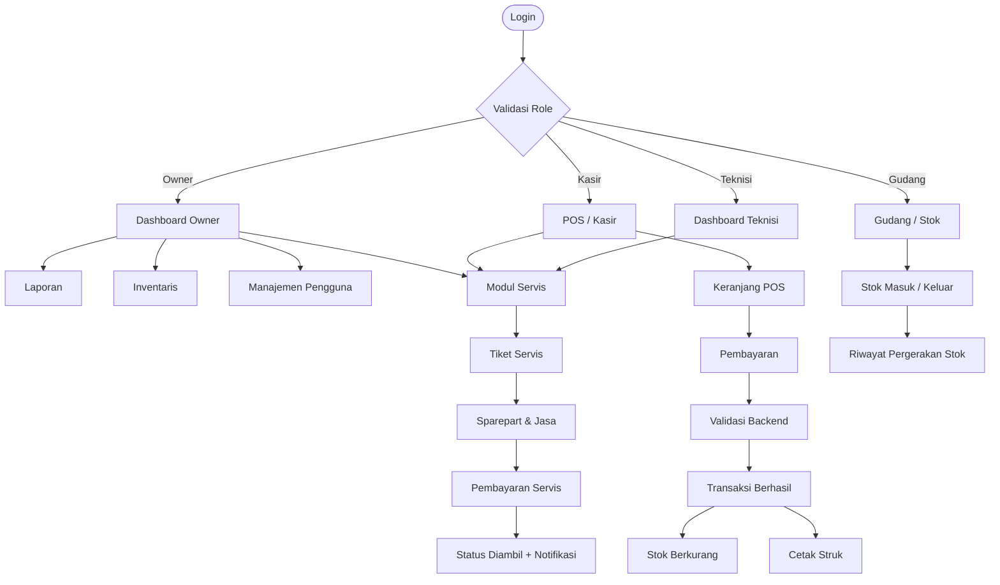

<div align="center">

<h1>🖥️ POS Servis</h1>
<h3>Sistem POS & Manajemen Servis Berbasis Web</h3>

<p>Mengelola transaksi penjualan, tiket servis, inventaris, pergerakan stok, pengguna, dan laporan operasional dalam satu aplikasi.</p>

<p>
  
  
  
  
</p>

<p>
  <a href="#-fitur-utama">Fitur</a> •
  <a href="#-teknologi">Teknologi</a> •
  <a href="#-alur-sistem">Alur Sistem</a> •
  <a href="#-instalasi">Instalasi</a> • 
  <a href="#-roadmap-pengembangan">Roadmap</a>
</p>

</div>

---

## 📌 Tentang Project

**POS Servis** adalah aplikasi web untuk operasional toko/layanan servis yang
menggabungkan kasir (POS), manajemen tiket servis, pengelolaan produk/sparepart,
pencatatan pergerakan stok, manajemen karyawan, serta laporan.

Sistem menerapkan pembagian hak akses berdasarkan peran pengguna
(*Role-Based Access Control*) sehingga setiap pengguna hanya dapat
mengakses fitur sesuai tanggung jawabnya.

> [!NOTE]
> Fitur inti POS + servis + role teknisi sudah berjalan dan teruji, termasuk notifikasi status servis, export CSV laporan, dan command backup/restore PostgreSQL.

## ✨ Fitur Utama

<details open>
<summary>
<strong>📊 Dashboard & Ringkasan</strong>
</summary>

-   Dashboard per role: Owner, Kasir, Gudang, Teknisi.
-   Ringkasan penjualan, transaksi, stok menipis, dan aktivitas terbaru.
-   Dashboard teknisi menampilkan antrean/tugas servis aktif dan tiket terakhir ditangani.
-   Transaksi yang dibatalkan tidak dihitung sebagai penjualan selesai.

</details>
<details open>
<summary>
<strong>🛒 Point of Sale (POS) & Transaksi</strong>
</summary>

-   Pencarian produk berdasarkan nama atau SKU.
-   Keranjang belanja dengan pengaturan kuantitas.
-   Perhitungan subtotal dan total otomatis.
-   Validasi stok dan harga kembali di sisi backend saat checkout.
-   Pembayaran tunai, nominal pembayaran, dan perhitungan kembalian.
-   Nomor invoice unik.
-   Detail transaksi, riwayat, dan alur pembatalan/pengajuan pembatalan.
-   Snapshot nama produk, SKU, dan harga pada detail transaksi.

</details>
<details open>
<summary>
<strong>🔧 Servis / Ticketing</strong>
</summary>

-   Tiket servis: data pelanggan, perangkat, keluhan, status, teknisi, dan biaya.
-   Status servis: antre, dicek, menunggu sparepart, selesai, diambil, batal.
-   Pemakaian sparepart dari stok produk dengan pencatatan `stock_movements`.
-   Pembayaran servis menghasilkan transaksi POS dan menghubungkan `service_tickets.transaction_id`.
-   Pembatalan transaksi servis mengembalikan tiket ke status selesai dan melepas transaksi.
-   Cetak tanda terima/nota servis.
-   Riwayat perubahan status servis (audit trail).
-   Notifikasi in-app saat status servis berubah/dibuat/dibayar.
-   Export laporan CSV (penjualan + servis) berdasarkan periode.
-   Command backup/restore database PostgreSQL (`db:backup`, `db:restore`).

</details>
<details>
<summary>
<strong>📦 Produk & Kategori</strong>
</summary>

-   Tambah, lihat, ubah, dan hapus data produk.
-   Pengelolaan kategori produk.
-   Informasi SKU, satuan, harga modal, harga jual, stok, dan batas
    minimum stok.
-   Status aktif/nonaktif produk.
-   Perubahan stok dilakukan melalui pencatatan pergerakan stok, bukan
    dengan mengubah stok langsung dari formulir produk.


</details>
<details>
<summary>
<strong>🔄 Pergerakan Stok</strong>
</summary>

-   Pencatatan stok masuk.
-   Pencatatan stok keluar.
-   Pencatatan penyesuaian stok.
-   Riwayat jumlah stok sebelum dan sesudah perubahan.
-   Pencatatan pengguna, waktu, referensi transaksi, dan alasan.
-   Validasi agar stok tidak menjadi negatif.


</details>
<details>
<summary>
<strong>👥 Manajemen Karyawan & Hak Akses</strong>
</summary>

-   Pengelolaan akun Kasir dan Gudang.
-   Pengaturan peran pengguna.
-   Aktivasi dan deaktivasi akun.
-   Password disimpan menggunakan mekanisme hashing Laravel.
-   Pembatasan akses halaman berdasarkan role di backend.


</details>
<details>
<summary>
<strong>🧾 Pembatalan Transaksi</strong>
</summary>

-   Owner dapat membatalkan transaksi yang selesai.
-   Alasan pembatalan dicatat.
-   Stok produk dikembalikan ketika pembatalan berhasil.
-   Pergerakan stok pengembalian tercatat dalam riwayat.
-   Informasi pembatalan dan pihak yang melakukan pembatalan tersimpan
    sebagai audit.

**Alur pengajuan oleh Kasir:** Kasir dapat mengirim pengajuan pembatalan
dengan alasan. Pengajuan disimpan sebagai `pending` dan transaksi tetap
berstatus selesai sampai diproses oleh Owner. Halaman daftar pengajuan
untuk Owner sudah tersedia, sedangkan proses persetujuan dan penolakan
masih dalam pengembangan.


</details>
<details>
<summary>
<strong>📈 Laporan</strong>
</summary>

-   Filter laporan berdasarkan rentang tanggal.
-   Ringkasan penjualan dan transaksi selesai.
-   Jumlah produk terjual dan produk terlaris.
-   Ringkasan servis: total tiket, selesai/aktif, omzet jasa, omzet sparepart servis.
-   Status tiket servis dan performa teknisi.
-   Daftar transaksi sesuai periode laporan.

</details>
## 🧑‍💼 Struktur Peran

| Peran | Tanggung Jawab |
|:---|:---|
| **Owner** | Akses penuh: dashboard, master data, karyawan, laporan, transaksi, pembatalan, dan servis. |
| **Kasir** | POS, riwayat/detail transaksi miliknya, pengajuan pembatalan, menerima tiket servis dan pembayaran servis. |
| **Gudang** | Kelola stok masuk/keluar/penyesuaian dan riwayat pergerakan stok. |
| **Teknisi** | Dashboard teknisi, melihat/mengupdate tiket servis yang ditugaskan atau belum ditugaskan, menambah/menghapus sparepart servis. |

## 🧰 Teknologi

| Teknologi | Kegunaan |
|:---|:---|
| [Laravel 13](https://laravel.com/) | Backend framework dan pola MVC |
| [PHP 8.3+](https://www.php.net/) | Bahasa pemrograman backend |
| [PostgreSQL](https://www.postgresql.org/) | Database relasional utama |
| [Blade](https://laravel.com/docs/blade) | Template view |
| [Bootstrap 5.3](https://getbootstrap.com/) | Styling dan komponen antarmuka |
| [Alpine.js](https://alpinejs.dev/) | Interaksi antarmuka |
| [Chart.js](https://www.chartjs.org/) | Visualisasi grafik dashboard |

## 🗺️ Alur Sistem

Diagram berikut menggambarkan alur utama aplikasi berdasarkan peran
pengguna dan proses transaksi.



### 🔁 Alur Checkout

1.  Kasir memilih produk dan memasukkannya ke keranjang.
2.  Sistem menghitung total belanja.
3.  Kasir memasukkan nominal pembayaran.
4.  Backend memvalidasi ulang produk, harga, dan ketersediaan stok.
5.  Jika valid, transaksi disimpan dan stok dikurangi.
6.  Sistem mencatat pergerakan stok serta menyediakan struk transaksi.

## ⚙️ Instalasi

Panduan berikut menggunakan **Windows + Laragon** sebagai lingkungan
pengembangan.

### 1. Persyaratan

Pastikan perangkat sudah memiliki:

-   PHP 8.3+ (disarankan sesuai `composer.json`).
-   Composer.
-   Node.js dan npm.
-   PostgreSQL 14+ (disarankan).
-   Ekstensi PHP: `pdo_pgsql`, `pgsql`.
-   Git.
-   Scoop (opsional, direkomendasikan jika kamu sudah pakai setup Scoop).

Jika pakai Scoop:

```powershell
scoop install postgresql php composer nodejs
php -m | findstr /i pgsql
```

### 2. Clone Repository

``` bash
git clone <repository-url>
cd pos-servis
```

### 3. Install Dependency

``` bash
composer install
npm install
```

### 4. Siapkan File Environment

Salin `.env.example` menjadi `.env`:

```powershell
Copy-Item .env.example .env
```

Jalankan PostgreSQL (contoh setup Scoop/profile kamu):

```powershell
pg-start
pg-status
```

Buat database:

```powershell
createdb -U root -h 127.0.0.1 -p 5432 bengkel_management
```

Sesuaikan `.env`:

```dotenv
APP_NAME="POS Servis"
APP_ENV=local
APP_DEBUG=true
APP_URL=http://127.0.0.1:8000

DB_CONNECTION=pgsql
DB_HOST=127.0.0.1
DB_PORT=5432
DB_DATABASE=bengkel_management
DB_USERNAME=root
DB_PASSWORD=
```

> Sesuaikan `DB_USERNAME` dan `DB_PASSWORD` dengan kredensial PostgreSQL lokal kamu. Jangan commit `.env`.

### 5. Generate Application Key

``` bash
php artisan key:generate
```

### 6. Jalankan Migration & Seeder

```bash
php artisan migrate
php artisan db:seed --class=RoleSeeder
php artisan db:seed --class=UserSeeder
```

Akun seeder default (untuk development lokal):

| Role | Email | Username | Password |
|---|---|---|---|
| Owner | `owner@tokokomputer.local` | `owner` | `owner` |
| Kasir | `kasir@tokokomputer.local` | `kasir` | `kasir` |
| Gudang | `gudang@tokokomputer.local` | `gudang` | `gudang` |
| Teknisi | `teknisi@tokokomputer.local` | `teknisi` | `teknisi` |

> Ganti password akun seeder sebelum dipakai di environment bersama/production.

### 7. Jalankan Aplikasi

Buka dua terminal di folder project.

**Terminal 1 --- Laravel:**

``` bash
php artisan serve
```

**Terminal 2 --- Vite:**

``` bash
npm run dev
```

Buka aplikasi melalui:

**http://127.0.0.1:8000**

### 8. Perintah Pengembangan

```bash
# Menjalankan test
php artisan test

# Test fitur servis yang sudah ada
php artisan test --filter=ServiceFlowTest

# Melihat daftar route
php artisan route:list

# Membersihkan cache aplikasi
php artisan optimize:clear

# Build asset untuk deployment
npm run build
```

Untuk test PostgreSQL, siapkan DB test terpisah (contoh: `pos_servis_test`) dan jalankan dengan env yang sesuai. `phpunit.xml` sudah dikonfigurasi untuk PostgreSQL; jangan simpan password production di file tersebut.

## 🗂️ Struktur Project

Berikut gambaran direktori utama Laravel. Detail file dapat berkembang
mengikuti implementasi project.

``` text
pos-servis/
├── app/
│   ├── Http/
│   │   ├── Controllers/
│   │   └── Middleware/
│   └── Models/
├── database/
│   ├── migrations/
│   └── seeders/
├── resources/
│   ├── css/
│   ├── js/
│   └── views/
├── routes/
│   └── web.php
├── public/
├── tests/
├── .env.example
└── README.md
```

## 🔐 Catatan Keamanan

-   File `.env` tidak boleh di-commit ke repository.
-   Gunakan password yang kuat untuk akun aplikasi.
-   Password pengguna harus disimpan dalam bentuk hash.
-   Validasi transaksi dan stok harus dilakukan di backend.
-   Gunakan transaksi database dan row locking untuk operasi stok yang
    kritis.
-   Pastikan middleware/otorisasi diterapkan pada route yang membutuhkan
    hak akses tertentu.
-   Untuk deployment, nonaktifkan debug (`APP_DEBUG=false`) dan gunakan
    konfigurasi production yang sesuai.

## 🚧 Roadmap Pengembangan

| Modul | Status |
|:---|:---:|
| Setup Laravel dan database PostgreSQL | ✅ Selesai |
| Login, logout, dan role middleware | ✅ Selesai |
| Dashboard per role (Owner/Kasir/Gudang/Teknisi) | ✅ Selesai |
| Manajemen kategori & produk | ✅ Selesai |
| Pergerakan stok | ✅ Selesai |
| POS dan checkout | ✅ Selesai |
| Tiket servis + sparepart + pembayaran servis | ✅ Selesai |
| Integritas cancel transaksi <-> tiket servis | ✅ Selesai |
| Policy/otorisasi object-level dasar | ✅ Selesai |
| Laporan penjualan + ringkasan servis | ✅ Selesai |
| Test fitur kritis servis + POS/cancel/policy | ✅ Selesai |
| Audit trail status servis | ✅ Selesai |
| Migrasi encrypt `device_password` lama | ✅ Selesai |
| Notifikasi status servis, export CSV laporan, backup/restore DB | ✅ Selesai |

## 🌿 Branch Git

Branch pengembangan yang digunakan:

-   `main` --- branch utama.
-   `development-branch` --- branch pengembangan aktif.

Contoh alur kerja:

``` bash
# Pindah ke branch pengembangan
git switch development-branch

# Periksa perubahan
git status

# Simpan perubahan
git add .
git commit -m "feat: deskripsi perubahan"

# Push ke GitHub
git push origin development-branch
```

Hindari memasukkan `.env`, file rahasia, kredensial, atau file lokal
yang tidak diperlukan ke dalam commit.

## 🤝 Kontribusi

Kontribusi, ide, dan laporan bug sangat dihargai.

1.  Fork repository.
2.  Buat branch fitur: `git switch -c fitur/nama-fitur`.
3.  Lakukan perubahan dan pengujian.
4.  Commit dengan pesan yang jelas.
5.  Push branch dan ajukan Pull Request.

## 📄 Lisensi

Lisensi project belum ditentukan. Sampai file lisensi ditambahkan ke
repository, jangan mengasumsikan project ini menggunakan lisensi
open-source tertentu.

## 👨‍💻 Pengembang

**POS Servis**

---

<div align="center">
Dibuat untuk membantu operasional penjualan dan layanan servis menjadi lebih teratur, efisien, dan mudah dipantau.

**Thank you for visiting this repository!**
</div>
